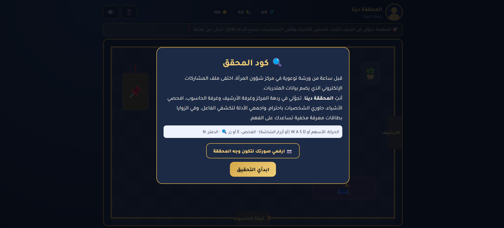
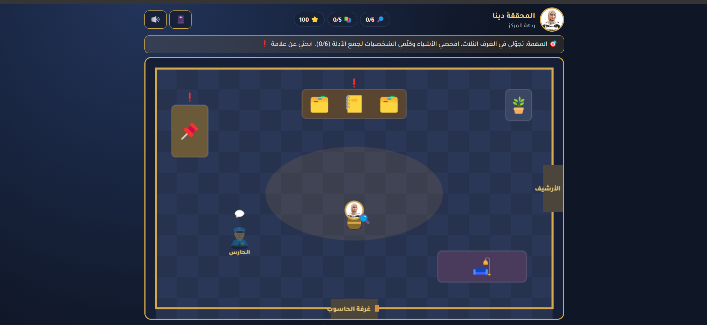
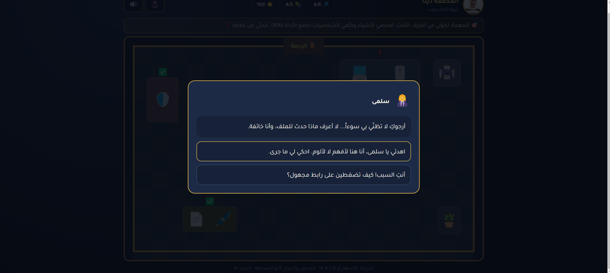
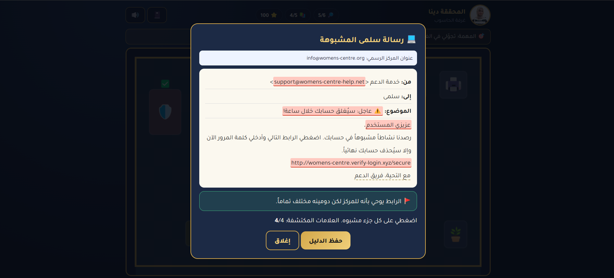
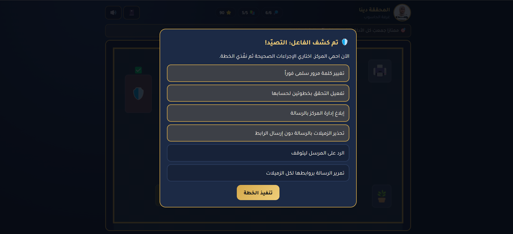
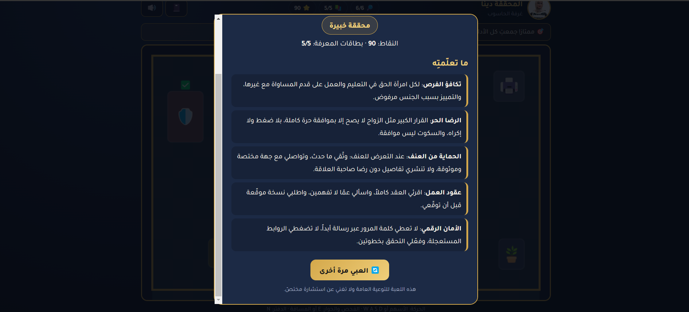

# 🔍 Detective Code — كود المحقق

An Arabic, browser-based **top-down detective game** that teaches women's rights, life skills and digital safety through exploration, not quizzes.
Built for awareness workshops at a Women's Affairs Centre.

**▶️ Play online:** https://dina-albaghdadi.github.io/detective-code-game/

> العربية بالأسفل ⬇️

---

## The Story

One hour before an awareness workshop, the centre's **electronic participants file**, holding the trainees' data, disappears.
You play **Detective Dina**: walk through three rooms, examine objects, talk to people respectfully, collect clues, and uncover who (or *what*) is behind it.

## How to Play

| Action | Keyboard | Mobile |
|---|---|---|
| Move | Arrow keys / `W A S D` | On-screen D-pad |
| Examine / Talk | `E` or `Space` | 🔍 button |
| Open notebook | `N` or 📓 | 📓 button |

- Look for the pulsing **❗** (objects) and **💬** (characters). They turn into **✅** once done.
- Walk into a door to move between the **Lobby**, the **Archive Room** and the **Computer Room**.
- Upload your own photo on the start screen to become the detective.

## Game Flow

1. **Explore & collect:** find **6 clues** and **5 hidden knowledge cards** across three rooms.
2. **Talk with respect:** in dialogues, a supportive tone opens up information, while blaming closes the conversation and costs points.

   

3. **Phishing analyser mini-game:** click the four red flags in a fake email (spoofed sender, urgency, generic greeting, look-alike link) and avoid the decoy.

   

4. **Accuse:** once all 6 clues are found, the notebook unlocks *"Who did it?"*. A wrong accusation explains, using evidence, why that suspect is innocent.
5. **Contain the damage:** choose the right protective actions and avoid the harmful ones.

   

6. **Case closed:** earn 1–3 stars and a title, with a summary of everything you learned.

   

### Scoring

Start at **100** points: blaming in a dialogue **−5**, clicking a normal part of the email **−2**, wrong accusation **−10**, harmful containment action **−5**.
⭐⭐⭐ 85+ *Expert Detective* · ⭐⭐ 60+ *Promising Detective* · ⭐ below 60 *Beginner Detective*

## What Players Learn

| Knowledge card | Message |
|---|---|
| Equal Opportunity | Every woman has an equal right to education and work. |
| Free Consent | Big decisions like marriage require full, free consent. Silence is not consent. |
| Protection from Violence | Document, reach a trusted specialised body, and never share details without consent. |
| Employment Contracts | Read the whole contract, ask questions, and get a signed copy. |
| Digital Safety | Never share passwords by message, don't click urgent links, and enable 2-step verification. |

## How It Was Built: The CTCO Prompt

This game was generated by AI from a single structured prompt that I wrote, applying the **CTCO** prompt-engineering framework I learned in an AI course. The full prompt is in [PROMPT.md](./PROMPT.md).

| CTCO | What the prompt defines |
|---|---|
| **Context** | Role (game developer + educational author), goal, target audience, the detective character, the story and suspects |
| **Task** | Build the three rooms, 6 clues, dialogues, the phishing mini-game, 5 knowledge cards, notebook, scoring, accusation and containment phases |
| **Constraints** | No multiple-choice quiz style, respectful tone, general (not country-specific) legal info, RTL Arabic design, responsive, single HTML file, no external libraries, no `localStorage` |
| **Output** | A ready-to-run HTML file, short usage notes, and two ideas for future development |

## Tech

- One self-contained `index.html`: HTML + CSS + vanilla JavaScript + Canvas
- No server, no build step, no libraries (only the Tajawal Google Font)
- Game content (rooms, clues, dialogues, cards) is stored in plain JS objects, so it's easy to edit
- Responsive, with touch controls on mobile

**Run locally:** download `index.html` and open it in any modern browser.

## Future Ideas

- A fourth room or a new case (e.g., online harassment or a fake job offer)
- Multiple endings based on the player's dialogue choices

> ⚠️ This game is for general awareness and is not a substitute for professional advice.

---

# 🔍 كود المحقق

لعبة تحقيق عربية تعمل في المتصفح بمنظور علوي، تنشر الوعي بحقوق المرأة والمهارات الحياتية والأمان الرقمي من خلال **الاستكشاف واتخاذ القرار**، وليس من خلال أسئلة اختيار من متعدد.
صُمّمت لورش التوعية في مركز شؤون المرأة.

**▶️ العبي الآن:** https://dina-albaghdadi.github.io/detective-code-game/

## القصة

قبل ساعة من ورشة توعوية، يختفي **ملف المشاركات الإلكتروني** الذي يضم بيانات المتدربات.
أنتِ **المحققة دينا**: تجوّلي في ثلاث غرف، افحصي الأشياء، حاوري الشخصيات باحترام، واجمعي الأدلة لتكشفي الفاعل.

## طريقة اللعب

| الإجراء | لوحة المفاتيح | الجوال |
|---|---|---|
| الحركة | الأسهم / `W A S D` | أزرار الاتجاهات على الشاشة |
| الفحص / الحوار | `E` أو المسافة | زر 🔍 |
| فتح الدفتر | `N` أو 📓 | زر 📓 |

- ابحثي عن علامة **❗** فوق الأشياء و**💬** فوق الشخصيات، وتتحول إلى **✅** بعد الانتهاء منها.
- امشي نحو الأبواب للتنقل بين **الردهة** و**غرفة الأرشيف** و**غرفة الحاسوب**.
- يمكنك رفع صورتك من شاشة البداية لتكوني وجه المحققة.

## مراحل اللعبة

1. **الاستكشاف والجمع:** اعثري على **6 أدلة** و**5 بطاقات معرفة** مخفية في الغرف الثلاث.
2. **الحوار باحترام:** الأسلوب الداعم يفتح المعلومات، وأسلوب اللوم يغلق الحوار ويخصم نقاطاً.

   

3. **محلل رسائل التصيّد:** اضغطي على العلامات الأربع المشبوهة في الرسالة المزيفة (عنوان المرسل، الاستعجال، التحية العامة، الرابط) وتجنّبي الجزء العادي.

   

4. **كشف الفاعل:** بعد جمع الأدلة الستة تُفتح شاشة «من الفاعل؟»، والاتهام الخاطئ يشرح بالدليل لماذا المشتبه به بريء.
5. **الاحتواء:** اختاري الإجراءات الصحيحة لحماية المركز وتجنّبي الإجراءات الضارة.

   

6. **إغلاق القضية:** تحصلين على 1 إلى 3 نجوم ولقب، مع ملخص لكل ما تعلّمتِه.

   

### النقاط

تبدأ النقاط بـ **100**: اللوم في الحوار **−5**، الضغط على جزء عادي في الرسالة **−2**، الاتهام الخاطئ **−10**، الإجراء الضار في الاحتواء **−5**.
⭐⭐⭐ من 85 فأكثر *محققة خبيرة* · ⭐⭐ من 60 فأكثر *محققة واعدة* · ⭐ أقل من 60 *محققة مبتدئة*

## ماذا تتعلّم اللاعبة؟

| بطاقة المعرفة | الرسالة |
|---|---|
| تكافؤ الفرص | لكل امرأة حق متساوٍ في التعليم والعمل. |
| الرضا الحر | القرارات الكبيرة مثل الزواج تحتاج موافقة حرة كاملة، والسكوت ليس موافقة. |
| الحماية من العنف | التوثيق، والتواصل مع جهة مختصة وموثوقة، وعدم النشر دون رضا صاحبة العلاقة. |
| عقود العمل | قراءة العقد كاملاً، والسؤال عمّا لا تفهمينه، وطلب نسخة موقّعة. |
| الأمان الرقمي | لا تعطي كلمة المرور عبر رسالة، لا تضغطي الروابط المستعجلة، وفعّلي التحقق بخطوتين. |

## كيف بُنيت اللعبة: برومبت CTCO

أُنشئت هذه اللعبة بالذكاء الاصطناعي من برومبت واحد منظّم كتبته بنفسي، طبّقت فيه إطار **CTCO** لهندسة البرومبت الذي تعلّمته في كورس الذكاء الاصطناعي. البرومبت كاملاً موجود في [PROMPT.md](./PROMPT.md).

| CTCO | ماذا يحدد البرومبت |
|---|---|
| **السياق (Context)** | الدور (مطوّر ألعاب ومؤلف محتوى تعليمي)، الهدف، الفئة المستهدفة، شخصية المحققة، القصة والمشتبه بهم |
| **المهمة (Task)** | بناء الغرف الثلاث، 6 أدلة، الحوارات، لعبة تحليل الرسالة، 5 بطاقات معرفة، الدفتر، النقاط، الكشف والاحتواء |
| **القيود (Constraints)** | ممنوع أسلوب أسئلة الاختيار من متعدد، نبرة محترمة، معلومات قانونية عامة غير مرتبطة ببلد، تصميم عربي RTL متجاوب، ملف HTML واحد، بدون مكتبات خارجية، بدون `localStorage` |
| **المخرجات (Output)** | ملف HTML جاهز للتشغيل، تعليمات قصيرة للاستخدام، واقتراحان للتطوير |

## التقنيات

- ملف واحد `index.html` يضم HTML وCSS وJavaScript وCanvas
- بدون خادم أو مكتبات (فقط خط Tajawal من Google Fonts)
- محتوى اللعبة (الغرف، الأدلة، الحوارات، البطاقات) في كائنات JavaScript واضحة وسهلة التعديل
- متجاوبة مع أزرار تحكم لمس على الجوال

**التشغيل محلياً:** حمّلي `index.html` وافتحيه في أي متصفح حديث.

## أفكار للتطوير

- غرفة رابعة أو قضية جديدة (مثل التحرش الإلكتروني أو عرض عمل وهمي)
- نهايات متعددة حسب اختيارات اللاعبة في الحوارات

> ⚠️ هذه اللعبة للتوعية العامة ولا تغني عن استشارة مختصّ.

